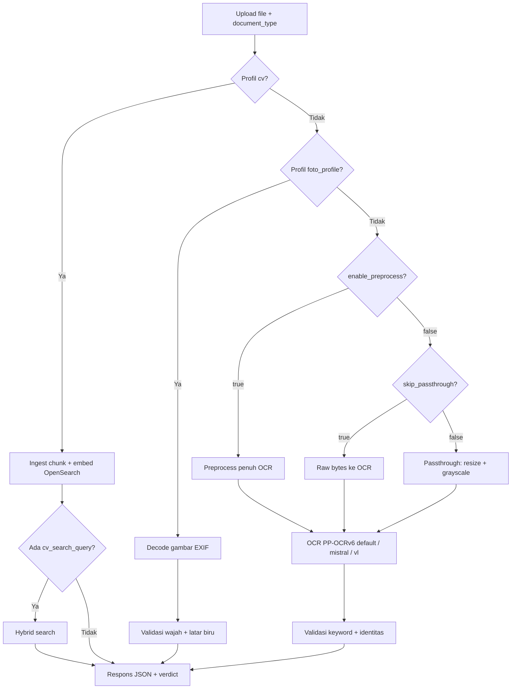
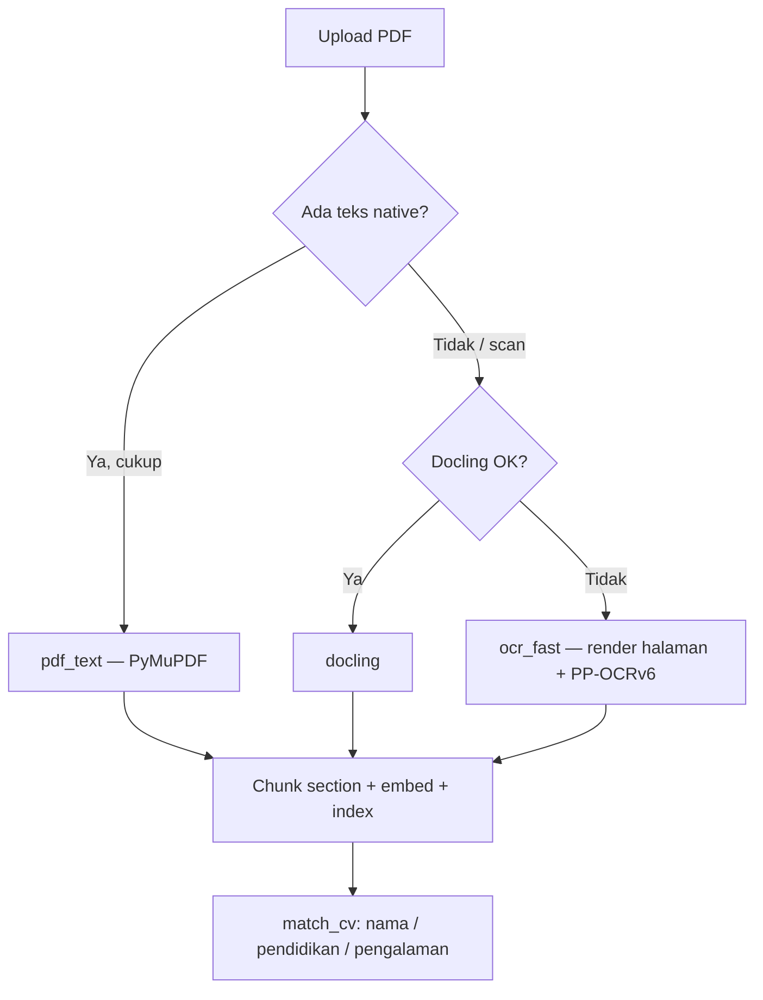

# API — spesifikasi & cara penggunaan

Dokumen **tunggal** untuk integrasi frontend/backend: endpoint, profil dokumen, aturan validasi, respons, dan pesan error UI.  
Install, Docker, dan catatan server: [README.md](./README.md).

## Base URL & cara penggunaan

| Lingkungan | Base URL |
|------------|----------|
| **Produksi** | `https://checkinpro-ocr.web.id` |
| Lokal (dev) | `http://127.0.0.1:8001` (env `PORT`) |

Dokumentasi interaktif (Swagger): [https://checkinpro-ocr.web.id/docs](https://checkinpro-ocr.web.id/docs)

**Spesifikasi ringkas JSON:** `GET /api/v1` — daftar endpoint, `document_types`, dan objek `frontend_errors` (kontrak `error_message` / `error_cases`).

UI pipeline: [https://checkinpro-ocr.web.id/pipeline](https://checkinpro-ocr.web.id/pipeline) · Benchmark dataset: [https://checkinpro-ocr.web.id/dataset-test](https://checkinpro-ocr.web.id/dataset-test)

### Quick start — validasi dokumen (disarankan)

Satu request **multipart** untuk upload gambar/PDF → OCR → validasi:

```bash
curl -X POST "https://checkinpro-ocr.web.id/api/v1/pipeline" \
  -F "file=@KTP_Siti.jpg" \
  -F "document_type=KTP" \
  -F "expected_name=Siti Dwi Sarah"
```

**Baca respons:**

| Field | Arti |
|-------|------|
| `success` | Request diproses tanpa error fatal |
| `document_matched` | Semua gate validasi lolos |
| `valid` | Sama dengan `document_matched` (alias untuk `foto_profile` / `cv`) |
| `error_code` | `null` jika lolos; kode tetap jika gagal validasi (mis. `ktp.name_mismatch`) |
| `error_message` | **Kalimat siap tampil di UI** jika gagal validasi; `null` jika lolos |
| `error_cases` | Array `{ code, message }` — tampilkan semua `message` bila lebih dari satu |
| `verdict.is_own_document` | `true` / `false` / `null` (null jika `expected_name` kosong) |
| `verdict.summary` | Ringkasan debug — **jangan** dipakai sebagai pesan utama ke user |

**Contoh JavaScript (fetch):**

```javascript
const API_BASE = "https://checkinpro-ocr.web.id";

const form = new FormData();
form.append("file", fileInput.files[0]);
form.append("document_type", "ktp");
form.append("expected_name", "Bagus Junda Winata");

const res = await fetch(`${API_BASE}/api/v1/pipeline`, {
  method: "POST",
  body: form,
});
const data = await res.json();

if (!res.ok) {
  const msg = data.detail?.error_message ?? "Gagal memproses dokumen.";
  console.error(msg, data.detail);
} else if (data.document_matched) {
  console.log("Lolos");
} else {
  console.log("Gagal:", data.error_message);
}
```

### Health check

```bash
curl -s "https://checkinpro-ocr.web.id/health" | jq .
curl -s "https://checkinpro-ocr.web.id/api/v1" | jq '.document_types'
```

### CV (curriculum vitae)

```bash
curl -X POST "https://checkinpro-ocr.web.id/api/v1/pipeline" \
  -F "file=@cv_Andika.pdf" \
  -F "document_type=cv" \
  -F "expected_name=Andika Pratama"
```

Respons: `validation_mode: "cv"`, `cv_match.matched`, `cv_match.dimensions` (nama / pendidikan / pengalaman).

### Foto profil (pas foto biru)

```bash
curl -X POST "https://checkinpro-ocr.web.id/api/v1/pipeline" \
  -F "file=@pas_foto.jpg" \
  -F "document_type=foto_profile"
```

Baca field **`valid`** (`true` = VALID). Tidak ada OCR.

---

**Engine OCR default pipeline:** **PP-OCRv6** lokal (`ocr_mode=fast`, tier `medium`). Mode `mistral` (cloud) dan `vl` (PaddleOCR-VL) opsional lewat query `ocr_mode`.

**Khusus `keterangan_kesehatan`:** OCR **wajib Ornith AI** (vision multimodal). Query `ocr_mode` / `pp_ocr_tier` **diabaikan**; Paddle tidak dipanggil. Lihat [Surat keterangan kesehatan](#keterangan_kesehatan).

---

## Daftar isi

1. [Konsep umum](#konsep-umum)
2. [Endpoint ringkas](#endpoint-ringkas)
3. [Pipeline utama (disarankan)](#pipeline-utama-disarankan)
4. [Profil dokumen & ketentuan validasi](#profil-dokumen--ketentuan-validasi)
5. [Endpoint per subsistem](#endpoint-per-subsistem)
6. [Struktur respons & verdict](#struktur-respons--verdict)
7. [Pesan error frontend (API spec)](#pesan-error-frontend-api-spec)
8. [Kode error HTTP](#kode-error-http)
9. [Variabel lingkungan](#variabel-lingkungan)

---

## Konsep umum

### `document_type`

String yang dikirim klien untuk menentukan **profil validasi**. Server menormalisasi ke ID kanonik (case-insensitive, alias didukung).

| ID kanonik | Label | Mode validasi |
|------------|-------|---------------|
| `ktp` | KTP | OCR + keyword fuzzy |
| `npwp` | NPWP | **Ornith AI** + `format_lama` (nomor bukan NIK 16 digit) |
| `kk` | Kartu Keluarga | OCR + keyword fuzzy |
| `rekening` | Rekening | **Ornith AI** — nama boleh sebagian atau tersensor |
| `mutasi` | Mutasi | OCR + keyword fuzzy |
| `skck` | SKCK | OCR + keyword fuzzy |
| `bpjs` | BPJS Kesehatan (KIS) | **Ornith AI** — nama boleh terpotong, NIK filename bisa menyelamatkan |
| `bpjs_tk` | BPJS Ketenagakerjaan | OCR + keyword AND/OR + identitas |
| `bpjs_kesanggupan` | Kesanggupan BPJS Kesehatan | OCR + keyword AND/OR + identitas |
| `jkn` | JKN (Info Peserta) | OCR + keyword OR + identitas |
| `iuran` | Iuran JKN (Info Iuran) | **Ornith AI** — Info Iuran, modal tanpa nama tetap lolos, NIK filename bisa lolos |
| `vaksinasi_1` | Vaksinasi COVID-19 (Dosis 1) | **Ornith AI** — dosis 1, nama boleh terpotong, NIK filename bisa lolos |
| `vaksinasi_2` | Vaksinasi COVID-19 (Dosis 2) | **Ornith AI** — dosis 2, nama boleh terpotong, NIK filename bisa lolos |
| `vaksinasi_3` | Vaksinasi COVID-19 (Booster) | **Ornith AI** — booster, nama boleh terpotong, NIK filename bisa lolos |
| `ijasah` | Ijazah | OCR + keyword fuzzy |
| `transkrip` | Transkrip Nilai | OCR + keyword fuzzy |
| `formulir_okb` | Formulir OKB | OCR + keyword fuzzy |
| `formulir_lamaran` | Formulir Lamaran Pekerjaan | OCR + keyword fuzzy |
| `surat_lamaran` | Surat Lamaran | OCR + keyword fuzzy |
| `pemadanan_npwp` | Pemadanan NPWP | **Ornith AI** — kartu NPWP 16 digit atau Ikhtisar Profil, nama boleh terpotong |
| `keterangan_kesehatan` | Surat Keterangan Kesehatan | **Ornith AI vision** (wajib) + gate SEHAT / tanggal / nama |
| `foto_profile` | Foto Profil | **Gambar** (wajah + latar biru) |
| `cv` | CV | **Ingest + match** 3 dimensi (nama / pendidikan / pengalaman) — bukan validasi OCR keyword |

Daftar lengkap alias ada di [Profil dokumen](#profil-dokumen--ketentuan-validasi).

### Gate validasi (dokumen teks/OCR)

Untuk profil selain `foto_profile`:

```
document_matched = document_type_pass AND (expected_name kosong ATAU identity_pass)
                   AND (bukan Helper KTP ATAU marital_pass)
```

| Gate | Default | Arti |
|------|---------|------|
| `document_type_pass` | aggregate ≥ **70%** | Rata-rata skor fuzzy keyword profil vs teks OCR |
| `identity_pass` | skor ≥ **65** | Nama diekstrak dari OCR vs `expected_name` (hanya jika nama diisi); kata nama harus cocok 1-1, bukan hanya satu token yang sama |
| `marital_pass` | Helper + KTP | Status perkawinan di KTP harus **BELUM KAWIN** bila `job_position=helper`. Posisi lain tidak dicek. |

Skor identitas = rata-rata `token_sort_ratio` dan cakupan kata (`token_coverage`). `WRatio`/`partial_ratio` tidak dipakai untuk lolos/gagal karena terlalu longgar pada nama yang hanya berbagi satu kata.

### Gate validasi (`foto_profile`)

```
valid = document_matched = is_profile_photo AND is_blue_background
```

**Ornith AI** (vision), bukan deteksi wajah OpenCV dan bukan Paddle. Query `ocr_mode` diabaikan. Respons: `ocr_mode: "ornith"`, `ocr.mode: "ornith_portrait_ai"`.

Lolos hanya jika gambar adalah **foto profil / pas foto** dan **latar belakang biru**. Jumlah atau ukuran wajah tidak dicek.

Jika AI tidak merespons: HTTP **503**, `detail.error_code` = `pipeline.portrait_ai_unavailable`.

| `error_code` (HTTP 200, gagal validasi) | Arti |
|-----------------------------------------|------|
| `foto_profile.not_profile_photo` | Bukan pas foto / foto profil |
| `foto_profile.not_blue` | Latar bukan biru solid |

### Field penting di respons

| Field | Tipe | Keterangan |
|-------|------|------------|
| `success` | boolean | Request diproses |
| `document_matched` | boolean | Semua gate relevan lolos |
| **`valid`** | boolean | **`foto_profile`:** alias langsung `document_matched` — **VALID / TIDAK VALID** |
| `verdict.summary` | string | Ringkasan bahasa Indonesia |
| `verdict.is_own_document` | bool \| null | `null` jika `expected_name` kosong |
| `verdict.document_type_current` | string \| null | Profil terdeteksi dari OCR/gambar |
| `validation_mode` | `"ocr"` \| `"image"` \| `"cv"` | `"image"` untuk `foto_profile`; `"cv"` untuk ingest CV |
| `issued_date` | `string \| null` | Tanggal dibuat (ISO), mis. surat kesehatan / SKCK |
| `issued_date_display` | `string \| null` | Tanggal dibuat format Indonesia, mis. `4 Juni 2026` |

### Engine OCR (`ocr_mode`)

| Nilai | Engine | Keterangan |
|-------|--------|------------|
| **`fast`** (default) | **PP-OCRv6** lokal | Tidak butuh API key; tier lewat `pp_ocr_tier` (default `medium`) |
| `mistral` | Mistral OCR cloud | Butuh `MISTRAL_API_KEY`; mendukung `document_annotation` untuk nama |
| `vl` | PaddleOCR-VL lokal | Layout parsing; set `full_json=true` untuk JSON penuh |

**Pengecualian:** `document_type=keterangan_kesehatan` selalu memakai **`ocr_mode: ornith`** / engine **`ornith_health_ai`** (bukan baris tabel di atas).

---

## Endpoint ringkas

| Method | Path | Content-Type | Fungsi |
|--------|------|--------------|--------|
| **POST** | **`/api/v1/pipeline`** | **multipart** | **OCR → validasi (1 request)** |
| GET | `/health` | — | Health check platform |
| GET | `/api/v1` | — | Daftar endpoint & `document_types` |
| GET | `/llm-fallback-log` | — | UI log fallback AI (dev/QA) |
| GET/DELETE | `/api/v1/llm-fallback-logs` | — | API log fallback AI (JSON) |
| POST | `/api/v1/preprocess` | multipart | Preprocess gambar saja |
| POST | `/systems/ocr/api/v1/ocr-mistral` | multipart | OCR cloud Mistral (opsional) |
| POST | `/systems/ocr/api/v1/ocr-fast` | multipart | **OCR lokal PP-OCRv6 (default pipeline)** |
| POST | `/systems/ocr/api/v1/ocr` | multipart | OCR lokal PaddleOCR-VL |
| POST | `/systems/validation/api/v1/validate-document` | JSON | Validasi teks OCR vs profil |
| GET | `/systems/validation/api/v1/error-catalog` | — | Katalog `error_code` + `error_message` untuk UI |
| POST | `/systems/validation/api/v1/validate-foto-profile` | multipart | Validasi foto profil biru (tanpa pipeline) |
| POST | `/systems/validation/api/v1/compare-names` | JSON | Bandingkan dua string nama |
| POST | `/systems/cv/api/v1/ingest` | multipart | Ingest CV (PDF/DOCX/MD/gambar) → OpenSearch |
| POST | `/systems/cv/api/v1/match` | JSON | Match CV terindeks (nama / pendidikan / pengalaman) |
| GET | `/systems/cv/api/v1/documents` | — | Daftar CV terindeks |
| DELETE | `/systems/cv/api/v1/documents/{doc_id}` | — | Hapus CV dari index |
| GET | `/api/v1/dataset/types` | — | Daftar folder `dataset/` + pemetaan `document_type` |
| GET | `/api/v1/dataset/file` | — | Preview/unduh file dataset (`folder` + `file` query) |
| POST | `/api/v1/dataset/benchmark` | JSON | Benchmark pipeline terhadap file dataset (NDJSON stream) |
| GET | `/api/v1/health-letter-ai/config` | — | Default URL/model Ornith + template prompt surat kesehatan |
| POST | `/api/v1/health-letter-ai` | multipart | Tes/debug: ekstraksi + validasi surat kesehatan via Ornith (tanpa Paddle) |
| GET/DELETE | `/api/v1/validation-failures` | — | Log JSONL dokumen gagal validasi (QA) |
| GET/DELETE | `/api/v1/validation-successes` | — | Log JSONL dokumen lolos validasi (QA) |
| GET | `/dataset-test` | — | UI benchmark dataset (dev): mode batch atau file spesifik |
| GET | `/dataset-failures` · `/dataset-successes` | — | UI review log benchmark/validasi |
| GET | `/health-letter-ai` | — | UI uji Ornith surat kesehatan |

---

## Pipeline utama (disarankan)

Satu request untuk upload gambar → validasi. Paling cocok untuk form upload di frontend.

### Request

```
POST /api/v1/pipeline
Content-Type: multipart/form-data
```

**Form fields**

| Field | Wajib | Keterangan |
|-------|-------|------------|
| `file` | ✅ | Gambar dokumen (JPEG, PNG, WebP, PDF page, dll.) |
| `document_type` | ✅ | ID kanonik atau alias, mis. `KTP`, `foto_profile` |
| `expected_name` | — | Nama referensi user; kosong = skip cek identitas |

**Query parameters**

| Param | Default | Keterangan |
|-------|---------|------------|
| `ocr_mode` | **`fast`** | **`fast`** = PP-OCRv6 lokal (default) \| `mistral` \| `vl` — **diabaikan untuk `foto_profile` dan `keterangan_kesehatan`** (Ornith AI) |
| `pp_ocr_tier` | `medium` | Tier PP-OCRv6 saat `ocr_mode=fast` (default): `balanced` \| `medium` \| `small` \| `tiny` |
| `include_preprocessed_image` | `false` | Sertakan `preprocessed_image.image_base64` |
| `enable_preprocess` | **`false`** | `true` = crop/rotate/enhance penuh sebelum OCR; `false` = passthrough ringan atau raw (lihat di bawah) |
| `skip_passthrough` | **`false`** | `true` = kirim bytes upload **langsung** ke OCR (tanpa resize/grayscale). Hanya efektif bila `enable_preprocess=false` |
| `full_json` | `false` | Hanya `ocr_mode=vl`: lampirkan `result_json` penuh |
| `cv_search_query` | — | Hanya `document_type=cv`: kata kunci hybrid search (legacy alias `expected_name`) |
| `cv_education_query` | — | Hanya `document_type=cv`: filter tambahan section pendidikan |
| `cv_experience_query` | — | Hanya `document_type=cv`: filter tambahan section pengalaman |

Tanpa query `ocr_mode`, pipeline memakai **PP-OCRv6** (`fast`) dengan tier **`medium`**.

### Preprocessing (`enable_preprocess` & `skip_passthrough`)

| Kombinasi | Perilaku |
|-----------|----------|
| default (`enable_preprocess=false`, `skip_passthrough=false`) | **Passthrough ringan:** decode EXIF → upscale/downscale (`PREPROCESS_MIN_SIDE_TARGET`) → **grayscale 8-bit** → OCR |
| `skip_passthrough=true` | **Raw ke OCR:** bytes upload diteruskan apa adanya (hanya dicek bisa didecode). Tanpa EXIF rotate, resize, atau grayscale |
| `enable_preprocess=true` | **Preprocess penuh:** resize, orientasi NPWP, dual-crop (bila perlu), warp kartu (env), enhance grayscale, lalu OCR. `skip_passthrough` **diabaikan** |

Metadata `preprocess` saat passthrough ringan (default):

| Field | Arti |
|-------|------|
| `skipped` | `true` |
| `light_upscale_only` | `true` |
| `grayscale_applied` | `true` |
| `encoding` | `grayscale_8bit_passthrough` |
| `resize_applied`, `resize_scale`, `resize_reason` | Info upscale/downscale |
| `resize_min_side_target_boosted` | `true` bila thumbnail kecil (<500px) naik target efektif otomatis |

Metadata `preprocess` saat `skip_passthrough=true`:

| Field | Arti |
|-------|------|
| `skipped` | `true` |
| `skip_passthrough` | `true` |
| `reason` | `direct_upload_bytes` |
| `encoding` | `raw_upload_bytes` |
| `mime` | MIME terdeteksi dari magic bytes upload |
| `input_bytes` | Ukuran file upload (byte) |

**Tips:** Thumbnail upload kecil (~300–500px) sering butuh upscale agresif; set `PREPROCESS_MIN_SIDE_TARGET=900` (atau lebih) di server. NPWP/portrait rumit tetap bisa butuh `enable_preprocess=true`.

### Contoh — KTP + cek nama (default PP-OCRv6)

```bash
curl -X POST "https://checkinpro-ocr.web.id/api/v1/pipeline" \
  -F "file=@KTP_Siti.jpg" \
  -F "document_type=KTP" \
  -F "expected_name=Siti Dwi Sarah"
```

### Contoh — KTP + raw ke OCR (tanpa passthrough)

```bash
curl -X POST "https://checkinpro-ocr.web.id/api/v1/pipeline?skip_passthrough=true" \
  -F "file=@KTP_scan_1200px.jpg" \
  -F "document_type=KTP" \
  -F "expected_name=Siti Dwi Sarah"
```

### Contoh — KTP + preprocess penuh (crop kartu)

```bash
curl -X POST "https://checkinpro-ocr.web.id/api/v1/pipeline?enable_preprocess=true" \
  -F "file=@KTP_foto_meja.jpg" \
  -F "document_type=KTP" \
  -F "expected_name=Siti Dwi Sarah"
```

### Contoh — KTP + Mistral OCR (opsional)

```bash
curl -X POST "https://checkinpro-ocr.web.id/api/v1/pipeline?ocr_mode=mistral" \
  -F "file=@KTP_Siti.jpg" \
  -F "document_type=KTP" \
  -F "expected_name=Siti Dwi Sarah"
```

### Contoh — Foto profil biru (tanpa OCR)

```bash
curl -X POST "https://checkinpro-ocr.web.id/api/v1/pipeline" \
  -F "file=@pas_foto.jpg" \
  -F "document_type=foto_profile"
```

Query `ocr_mode`, `enable_preprocess`, dan `pp_ocr_tier` **diabaikan** untuk profil ini. Lihat [Foto profil (`foto_profile`)](#foto_profile).

### Contoh — CV PDF + match nama

```bash
curl -X POST "https://checkinpro-ocr.web.id/api/v1/pipeline?cv_education_query=S1%20Teknik%20Informatika&cv_experience_query=Python%20backend" \
  -F "file=@dataset/cv/cv_Usep_Maulidin.pdf" \
  -F "document_type=cv" \
  -F "expected_name=Usep Maulidin"
```

Query CV (semua **query string**, bukan form field):

| Param | Fungsi |
|-------|--------|
| `cv_search_query` | Legacy alias `expected_name` untuk nama |
| `cv_education_query` | Kata kunci tambahan section pendidikan |
| `cv_experience_query` | Kata kunci tambahan section pengalaman |

Respons: `validation_mode: "cv"`, `cv_ingest`, `cv_match`. Detail PDF & gate match → [CV (`cv`)](#cv).

### Contoh — JavaScript (fetch)

```javascript
const API_BASE = "https://checkinpro-ocr.web.id";

const form = new FormData();
form.append("file", fileInput.files[0]);
form.append("document_type", "ktp");
form.append("expected_name", "Bagus Junda Winata");

const res = await fetch(`${API_BASE}/api/v1/pipeline`, {
  method: "POST",
  body: form,
});
const data = await res.json();

if (data.document_matched) {
  console.log(data.verdict.summary);
} else {
  console.log(data.validation.explanation.detail_lines);
}
```

### Alur internal



---

## Profil dokumen & ketentuan validasi

### Ringkasan per case

| Profil | `document_type` contoh | Wajib isi `expected_name`? | OCR? | Lolos jika |
|--------|------------------------|----------------------------|------|------------|
| KTP | `ktp`, `KTP`, `identitas` | Opsional (disarankan untuk cek milik) | ✅ | Keyword KTP ≥70% **dan** (nama kosong **atau** identitas ≥65) |
| NPWP | `npwp`, `NPWP` | Opsional | ✅ | Keyword NPWP ≥70% **dan** identitas (jika dicek) |
| KK | `kk`, `kartu keluarga` | Opsional | ✅ | Keyword KK ≥70%; nama bisa dari baris tabel anggota |
| Rekening | `rekening`, `rekening tabungan` | Opsional | ❌ (AI vision) | **Ornith** — bukti tabungan, `expected_bank` wajib; nama dan nomor rekening keduanya cocok bila keduanya diisi |
| Mutasi | `mutasi`, `e-statement` | Tidak dipakai | ✅ | Ada `tabungan` **dan** `e-statement`; `expected_bank` + `expected_account` wajib |
| SKCK | `skck` | Opsional | ✅ | Ada `skck` / `kepolisian` |
| BPJS KIS | `bpjs`, `bpjs kesehatan`, `kartu indonesia sehat` | **Disarankan wajib** | ❌ (AI vision) | **Ornith** — KIS, nama boleh terpotong, NIK filename bisa lolos |
| BPJS TK | `bpjs_tk`, `bpjs ketenagakerjaan` | **Disarankan wajib** | ✅ | Keyword kartu TK ≥70% **dan** identitas (jika nama diisi) |
| Kesanggupan BPJS | `bpjs_kesanggupan`, `kesanggupan bpjs` | **Disarankan wajib** | ✅ | Surat kesanggupan ≥70%, **materai**, **dan** identitas (jika nama diisi) |
| JKN | `jkn`, `info peserta` | **Disarankan wajib** | ✅ | Ada `info peserta` **atau** `faskes` **dan** identitas ≥65 (jika nama diisi). Status AKTIF/TIDAK AKTIF diekstrak, tidak memblokir |
| Iuran JKN | `iuran`, `info iuran`, `iuran jkn` | **Disarankan wajib** | ❌ (AI vision) | **Ornith** — layar Info Iuran; modal tanpa nama lolos; nama boleh terpotong; NIK filename bisa lolos |
| Vaksinasi 1 | `vaksinasi_1`, `vaksinasi 1`, `vaksin dosis pertama` | **Disarankan wajib** | ❌ (AI vision) | **Ornith** — dosis 1 (tahap 2 ikut tercantum tetap lolos), nama boleh terpotong, NIK filename bisa lolos |
| Vaksinasi 2 | `vaksinasi_2`, `vaksinasi 2` | **Disarankan wajib** | ❌ (AI vision) | **Ornith** — dosis 2 (tahap 1 ikut tercantum tetap lolos), nama boleh terpotong, NIK filename bisa lolos |
| Vaksinasi 3 | `vaksinasi_3`, `vaksinasi 3`, `vaksin booster` | **Disarankan wajib** | ❌ (AI vision) | **Ornith** — booster (tahap 1/2 ikut tercantum tetap lolos), primer 2 bukan booster |
| Ijazah | `ijasah`, `ijazah` | Opsional | ✅ | Keyword ijazah/pendidikan ≥70% |
| Transkrip | `transkrip`, `transkrip nilai` | Opsional | ✅ | Keyword transkrip/nilai ≥70% |
| Formulir OKB | `formulir_okb`, `formulir okb` | Opsional | ✅ | Keyword formulir OKB ≥70% |
| Formulir lamaran | `formulir_lamaran`, `formulir lamaran pekerjaan` | Opsional | ✅ | Keyword lamaran pekerjaan ≥70% |
| Surat lamaran | `surat_lamaran`, `surat lamaran` | Opsional | ✅ | Keyword surat lamaran ≥70% |
| Pemadanan NPWP | `pemadanan_npwp`, `pemadanan npwp` | Opsional | ❌ (AI vision) | **Ornith** — kartu NPWP 16 digit atau Ikhtisar Profil; format lama 15 digit tidak lolos |
| Surat keterangan kesehatan | `keterangan_kesehatan`, `keterangan kesehatan` | Opsional | ✅ | Keyword ≥70%, nama (jika diisi), tertera SEHAT, tanggal dari dokumen (kadaluarsa hanya jika surat menulis sampai/durasi) |
| CV | `cv`, `resume`, `curriculum vitae` | Disarankan (dimensi nama) | ❌ (match struktural) | **PDF/DOCX/MD/gambar** → ingest + match nama/pendidikan/pengalaman |
| Foto Profil | `foto_profile`, `pas foto` | Tidak dipakai | ❌ (AI vision) | **JPEG/PNG/WebP** — pas foto **dan** latar biru (Ornith) |

---

### `ktp`

**Alias:** `kartu tanda penduduk`, `id card`, `identitas`

**Keyword yang dicek (fuzzy, rata-rata ≥70%):**

- `nik`, `nama`, `provinsi`, `kabupaten`, `agama`, `kewarganegaraan`, `status perkawinan`

**Bonus skor (structural):**

- NIK 16 digit di OCR
- Kata `nik`

**Identitas:** Ekstraksi nama dari baris `Nama` di OCR; prioritas `holder_name` dari Mistral `document_annotation` bila `ocr_mode=mistral`.

**Tips upload:** Foto kartu fisik — set `PREPROCESS_CARD_WARP=1` agar kartu terisolasi dari latar.

```bash
curl -X POST "https://checkinpro-ocr.web.id/api/v1/pipeline" \
  -F "file=@KTP.jpg" \
  -F "document_type=ktp" \
  -F "expected_name=Nama Lengkap Sesuai KTP"
```

---

### `npwp`

**Alias:** `nomor pokok wajib pajak`, `npwp 16 digit`

**Mode:** Ornith AI (`ocr_mode` diabaikan). Gagal AI → HTTP 503 `pipeline.npwp_ai_unavailable`.

**Gate:** gambar adalah NPWP; nama vs `expected_name` bila diisi; NIK 16 digit dari filename hanya jika nomor di kartu berformat NIK.

**`format_lama`:** `true` jika nomor NPWP **bukan** 16 digit (format lama / belum pemadanan). `false` jika nomor 16 digit seperti NIK. Flag ini ada di root respons dan di `validation`. Tidak menggagalkan `document_matched`.

Nomor 16 digit yang cocok dengan NIK filename tetap lolos meski nama AI meleset.

```bash
curl -X POST "https://checkinpro-ocr.web.id/api/v1/pipeline" \
  -F "file=@NPWP.jpg" \
  -F "document_type=npwp" \
  -F "expected_name=Nama Wajib Pajak"
```

---

### `pemadanan_npwp`

**Alias:** `pemadanan npwp`

**Mode:** Ornith AI (`ocr_mode` diabaikan). Gagal AI → HTTP 503 `pipeline.pemadanan_npwp_ai_unavailable`.

**Gate:** kartu NPWP baru (nomor 16 digit) atau screenshot Ikhtisar Profil DJP. Kartu NPWP format lama 15 digit tidak lolos. Nama boleh terpotong. Nomor 16 digit yang sama dengan NIK filename tetap lolos meski nama meleset.

```bash
curl -X POST "https://checkinpro-ocr.web.id/api/v1/pipeline" \
  -F "file=@ikhtisar.jpg" \
  -F "document_type=pemadanan_npwp" \
  -F "expected_name=Nama Wajib Pajak"
```

---

### `kk`

**Alias:** `kartu keluarga`

**Keyword:** `kartu keluarga`, `kepala keluarga`, `nik`

**Identitas khusus:** Bila nama referensi diisi, sistem juga memindai **baris tabel anggota** KK (bukan hanya kepala keluarga).

```bash
curl -X POST "https://checkinpro-ocr.web.id/api/v1/pipeline" \
  -F "file=@KK.jpg" \
  -F "document_type=kk" \
  -F "expected_name=Anggota Keluarga"
```

---

### `rekening`

**Alias:** `rekening koran`, `rekening tabungan`

**Mode:** Ornith AI (`ocr_mode` diabaikan). Gagal AI → HTTP 503 `pipeline.rekening_ai_unavailable`. Balasan kosong atau bukan JSON dicoba sekali lagi sebelum 503.

**Yang dihitung sebagai bukti tabungan**

- Halaman detail rekening tabungan (bukan e-statement).
- Beranda aplikasi yang menampilkan nama pemilik dan nomor tabungan, misalnya "Halo, NAMA" bersama "MAS Saving".

Label produk (`Tabungan NOW`, `Tabungan Payroll`, `Livin`, `Detail Rekening`) bukan nama pemilik. Nomor 16 digit di kartu debit bukan nomor rekening.

**Validasi rekening (3 payload):**

| Payload | Wajib? | Aturan |
|---------|--------|--------|
| `expected_bank` | **Ya** | Harus `mandiri` atau `mas` — bank **wajib** cocok |
| `expected_name` | Opsional | Nama pemilik. Boleh sebagian, tersensor (`Dxxa`), atau menempel (`andhrafitriyani`) |
| `expected_account` | Opsional | Nomor rekening. Mandiri **13 digit**, MAS **10 digit** |

Bila nama **dan** nomor rekening sama-sama diisi, **keduanya** harus cocok. Dua pengecualian:

- Nama orang tidak tercetak, tetapi nomor rekening cocok → lolos.
- Angka yang terlihat 11–12 digit (bukan nomor rekening 10 atau 13 digit) dan nama lengkap sudah cocok → lolos. Nomor 10 atau 13 digit yang berbeda tetap gagal.

Nomor yang hilang satu atau dua digit tetap cocok bila 6 digit pertama sama. Satu digit yang salah pada nomor 13 digit juga tetap cocok.

Pola filename benchmark: `rekening bank_{Nama}_{NoRek}.ext`. Nomor 10 digit dianggap Bank MAS, selain itu Mandiri.

| Bank | Tanda di gambar | Pola no. rekening |
|------|-----------------|-------------------|
| **Mandiri** | `livin`, `bank mandiri`, `detail rekening` | **13 digit** (awalan `156`, `173`, `166`, …) |
| **MAS** | `bank mas`, `mas saving`, `bebaspoin` | **10 digit** (umumnya awalan `100` atau `120`) |

> E-statement dan mutasi ditolak pada profil `rekening` (`rekening.wrong_type_statement`).

```bash
curl -X POST "https://checkinpro-ocr.web.id/api/v1/pipeline" \
  -F "file=@Rekening_Mandiri.jpg" \
  -F "document_type=rekening" \
  -F "expected_bank=mandiri" \
  -F "expected_account=1560027601493" \
  -F "expected_name=Adinda Putri Khalista"
```

`document_matched` = bukti tabungan (bukan e-statement) **dan** `bank_pass` **dan** nama serta nomor rekening sesuai aturan di atas.

---

### `mutasi`

**Alias:** `mutasi rekening`, `e-statement`

**Keyword wajib (keduanya):** `tabungan`, `e-statement`

**Validasi bank + rekening (wajib keduanya):**

| Payload | Wajib? |
|---------|--------|
| `expected_bank` | **Ya** — `mandiri` atau `mas` |
| `expected_account` | **Ya** — nomor rekening 10–13 digit |

**Identitas:** `expected_name` **tidak** dicek untuk profil mutasi.

Pola filename benchmark: `mutasi rekening_{Nama}_{NoRek}.ext`

`document_matched` = keyword dokumen OK **dan** `bank_pass` **dan** `account_pass`.

```bash
curl -X POST "https://checkinpro-ocr.web.id/api/v1/pipeline" \
  -F "file=@Mutasi.jpg" \
  -F "document_type=mutasi" \
  -F "expected_bank=mandiri" \
  -F "expected_account=1560027756370"
```

---

### `skck`

**Alias:** `surat keterangan catatan kepolisian`

**Keyword:** `skck`, `kepolisian`

```bash
curl -X POST "https://checkinpro-ocr.web.id/api/v1/pipeline" \
  -F "file=@SKCK.jpg" \
  -F "document_type=skck" \
  -F "expected_name=Nama Pemohon"
```

---

### `keterangan_kesehatan`

**Alias:** `keterangan kesehatan`, `surat keterangan kesehatan`, `surat sehat`

**OCR:** **Ornith AI** (OpenAI-compatible vision di `LLM_HEALTH_AI_BASE_URL`). Bukan Paddle/Mistral. Respons pipeline: `ocr_mode: "ornith"`, `ocr_engine: "ornith"`, `ocr.mode: "ornith_health_ai"`.

**Validasi (setelah ekstraksi AI):**

| Gate | Keterangan |
|------|------------|
| Jenis dokumen | Harus surat keterangan kesehatan / MCU (bukan surat buta warna, vaksin, dll.) |
| `identity_pass` | Jika `expected_name` diisi — fuzzy nama ≥ 65 |
| `health_status_pass` | Kesimpulan **SEHAT** |
| `health_expiry_pass` | Tanggal dibuat terbaca; kadaluarsa hanya jika surat menulis masa berlaku / sampai tanggal |
| `issued_date` | ISO `YYYY-MM-DD` + `issued_date_display` (Bahasa Indonesia), mis. `4 Juni 2026` |

**Kode error validasi (HTTP 200, `document_matched: false`):**

| `error_code` | `error_message` (ringkas) |
|--------------|---------------------------|
| `keterangan_kesehatan.wrong_document` | Bukan surat keterangan kesehatan yang valid |
| `keterangan_kesehatan.name_mismatch` | Nama pada surat tidak cocok |
| `keterangan_kesehatan.not_healthy` | Tidak dinyatakan SEHAT |
| `keterangan_kesehatan.date_missing` | Tanggal cek kesehatan tidak terbaca |
| `keterangan_kesehatan.expired` | Surat sudah kadaluarsa |

**Error transport (Ornith down / respons kosong):** HTTP **503**, `detail.error_code`: `pipeline.health_ai_unavailable`, pesan: *OCR AI surat kesehatan tidak merespons. Coba lagi nanti.*

```bash
curl -X POST "https://checkinpro-ocr.web.id/api/v1/pipeline" \
  -F "file=@surat_sehat.jpg" \
  -F "document_type=keterangan_kesehatan" \
  -F "expected_name=Citra Amelia"
```

**Contoh cuplikan sukses:**

```json
{
  "success": true,
  "ocr_mode": "ornith",
  "ocr_engine": "ornith",
  "document_matched": true,
  "ocr": {
    "mode": "ornith_health_ai",
    "model": "ornith-1.5-9b",
    "extraction": { "holder_name": "Citra Amelia", "issued_date": "2026-06-04" }
  },
  "validation": {
    "issued_date": "2026-06-04",
    "issued_date_display": "4 Juni 2026",
    "health_status_pass": true,
    "health_expiry_pass": true,
    "health_ai": { "llm": { "latency_s": 3.2 }, "extraction": { } }
  }
}
```

**Debug / QA tanpa pipeline penuh:** `POST /api/v1/health-letter-ai` (lihat di bawah).

---

---

### `bpjs`

**Alias:** `bpjs kesehatan`, `kartu indonesia sehat`, `kis`, `kartu kis`

**Dokumen:** Kartu Indonesia Sehat (KIS) — kartu fisik/digital BPJS Kesehatan.

**Mode:** Ornith AI (`ocr_mode` diabaikan). Gagal AI → HTTP 503 `pipeline.bpjs_ai_unavailable`.

**Gate:** gambar adalah kartu BPJS Kesehatan (bukan TK, info iuran, atau vaksin). Nama di kartu boleh terpotong (`TIARA` lolos untuk `Tiara Putri`). NIK 16 digit di kartu yang sama dengan NIK di nama file tetap lolos meski nama tidak lengkap.

**Identitas:** nama peserta dan NIK diekstrak oleh AI, lalu dicocokkan dengan `expected_name` dan NIK filename.

```bash
curl -X POST "https://checkinpro-ocr.web.id/api/v1/pipeline" \
  -F "file=@bpjs_Bagus.jpg" \
  -F "document_type=bpjs" \
  -F "expected_name=Bagus Junda Winata"
```

---

### `bpjs_tk`

**Alias:** `bpjs ketenagakerjaan`, `bpjs tk`, `jaminan ketenagakerjaan`, `kartu peserta bpjs`

**Dokumen:** Kartu Peserta BPJS Ketenagakerjaan (jaminan sosial tenaga kerja).

**Keyword (fuzzy ≥70%, AND antar grup):**

1. Wajib: `kartu peserta`
2. Minimal satu dari: `ketenagakerjaan`, `bpjs ketenagakerjaan`

**Identitas:** Nama peserta (huruf kapital di kartu) dibandingkan dengan `expected_name` bila diisi.

**Keyword terlarang (exclusion):** `syarat dan ketentuan`, `faskes tingkat`, `info iuran`, `kepesertaan terdaftar`

**Preprocess:** Foto kartu fisik — isolasi kartu seperti KTP.

```bash
curl -X POST "https://checkinpro-ocr.web.id/api/v1/pipeline" \
  -F "file=@bpjs_tk_Jorgi.jpg" \
  -F "document_type=bpjs_tk" \
  -F "expected_name=Jorgi Korleone"
```

---

### `bpjs_kesanggupan`

**Alias:** `kesanggupan bpjs`, `bpjs kesanggupan`, `surat kesanggupan bpjs`, `surat pernyataan kesanggupan`, `kesanggupan menanggung biaya`

**Dokumen:** Surat Pernyataan Kesanggupan Menanggung Biaya BPJS Kesehatan (karyawan).

**Keyword (fuzzy ≥70%, AND antar grup):**

1. Minimal satu: `surat pernyataan kesanggupan`, `menanggung biaya bpjs kesehatan`, `menanggung biaya bpjs`
2. Minimal satu: `tidak aktif`, `menanggung secara pribadi`, `syarat bekerja`, `peserta mandiri`, `virtual account`

**Identitas:** Nama dari field `Nama Lengkap` / tanda tangan; dibandingkan dengan `expected_name` bila diisi.

**Materai (wajib):** Stempel materai fisik (merah/keemasan) di area tanda tangan. Label kotak `Materai Rp10.000` tanpa stempel **tidak** lolos. Kode gagal: `bpjs_kesanggupan.stamp_missing`.

**Keyword terlarang (exclusion):** `kartu indonesia sehat`, `ketenagakerjaan`

```bash
curl -X POST "https://checkinpro-ocr.web.id/api/v1/pipeline" \
  -F "file=@bpjs_kesanggupan.jpg" \
  -F "document_type=bpjs_kesanggupan" \
  -F "expected_name=Egy Subagja"
```

---

### `jkn`

**Alias:** `jaminan kesehatan nasional`, `info peserta`, `mobile jkn`

**Keyword (minimal satu harus terbaca, fuzzy ≥70%):**

- `info peserta` **atau** `faskes`

**Identitas:** Wajib dicek bila `expected_name` diisi — nama peserta di kartu Mobile JKN (biasanya huruf kapital; boleh salah satu anggota keluarga).

**Status (ekstraksi, bukan gate):** Status kartu peserta yang namanya cocok dikembalikan di `jkn_status_label` (`aktif` \| `tidak_aktif` \| `null`) dan `jkn_status_display` (`AKTIF` / `TIDAK AKTIF`). Tidak menggagalkan `document_matched`.

**Keyword terlarang (exclusion):** `info iuran`, `total tagihan`, `tidak memiliki tagihan pribadi`, `kartu indonesia sehat`, `bpjs ketenagakerjaan`

**Preprocess:** Screenshot aplikasi — isolasi kartu fisik dilewati (sama seperti mutasi/rekening).

```bash
curl -X POST "https://checkinpro-ocr.web.id/api/v1/pipeline" \
  -F "file=@JKN_Info_Peserta.jpg" \
  -F "document_type=jkn" \
  -F "expected_name=Bagus Junda Winata"
```

---

### `iuran`

**Alias:** `info iuran`, `iuran jkn`, `tagihan jkn`, `iuran bpjs`

**Mode:** Ornith AI (`ocr_mode` diabaikan). Gagal AI → HTTP 503 `pipeline.iuran_ai_unavailable`.

**Layar:** Mobile JKN → **Info Iuran** (bukan Info Peserta, kartu KIS, atau vaksin).

| Case | Ciri layar | Identitas |
|------|------------|-----------|
| A — ada nama peserta | Tagihan, sisa saldo, kartu peserta, atau chat Pandawa (Nama Peserta + Tagihan) | Nama boleh terpotong atau tersensor (`RIXXX`). NIK 16 digit yang sama dengan nama file tetap lolos |
| B — tanpa nama | Modal «tidak memiliki tagihan pribadi», atau «tidak memiliki riwayat pembayaran iuran» | Nama tidak tampil, identitas lolos |

```bash
curl -X POST "https://checkinpro-ocr.web.id/api/v1/pipeline" \
  -F "file=@iuran_Jorgi.jpg" \
  -F "document_type=iuran" \
  -F "expected_name=Jorgi Korleone"
```

---

### `vaksinasi_1`

**Alias:** `vaksinasi 1`, `vaksinasi covid dosis 1`, `sertifikat vaksin covid`, `kartu vaksinasi covid`, `vaksin dosis pertama`, `covid-19 vaksin dosis pertama`

**Dokumen:** Kartu / surat / screenshot aplikasi yang membuktikan **vaksinasi COVID-19 dosis pertama**.

**Keyword (fuzzy ≥70%, AND antar grup):**

1. Minimal satu: `kartu vaksinasi covid`, `surat keterangan vaksinasi`, `covid-19 vaksin`, `sertifikat vaksinasi covid`, `international covid-19 vaccination`
2. Minimal satu: `vaksin primer 1`, `dosis pertama`, `1st dose`, `vaksin dosis pertama`, `telah selesai di vaksin 1`, `untuk dosis pertama`

**Case yang didukung:**

| Case | Ciri dokumen |
|------|----------------|
| A — Kartu SATUSEHAT | `Kartu Vaksinasi COVID-19` + `VAKSIN PRIMER 1` |
| B — Screenshot aplikasi | `COVID-19 Vaksin Dosis Pertama` + `Diberikan kepada` |
| C — Surat keterangan | `Surat Keterangan Vaksinasi COVID-19` + `dosis pertama` / `1st dose` |
| D — Riwayat vaksin (GERMAS) | `KARTU VAKSINASI COVID-19` + `TELAH SELESAI DI VAKSIN 1` |
| E — Sertifikat internasional | Sertifikat internasional + baris dosis pertama bernilai `1` |

**Identitas:** Nama penerima vaksin (huruf kapital di kartu, field `Diberikan kepada`, atau `Nama Lengkap`); dibandingkan dengan `expected_name` bila diisi.

**Keyword terlarang (exclusion):** `info peserta`, `info iuran` — kartu primer 2/booster tanpa dosis 1 ditolak via pengecekan struktural (`vaksinasi_1_wrong_dose_primary`)

**Preprocess:** Screenshot aplikasi — isolasi kartu fisik dilewati.

```bash
curl -X POST "https://checkinpro-ocr.web.id/api/v1/pipeline" \
  -F "file=@vaksinasi_1_Bagus.jpg" \
  -F "document_type=vaksinasi_1" \
  -F "expected_name=Bagus Junda Winata"
```

---

### `vaksinasi_2`

**Alias:** `vaksinasi 2`, `vaksin dosis kedua`

**Mode:** Ornith AI (`ocr_mode` diabaikan). Gagal AI → HTTP 503 `pipeline.vaksinasi_2_ai_unavailable`.

Dosis kedua tetap lolos jika riwayat juga memuat tahap 1. Booster saja tidak lolos. Nama boleh terpotong. NIK 16 digit dari filename yang cocok dengan kartu tetap lolos meski nama tidak lengkap.

**Input:** `expected_name` disarankan.

**Error:** `vaksinasi_2.wrong_document` · `vaksinasi_2.name_mismatch`

---

### `vaksinasi_3`

**Alias:** `vaksinasi 3`, `vaksin booster`

**Mode:** Ornith AI (`ocr_mode` diabaikan). Gagal AI → HTTP 503 `pipeline.vaksinasi_3_ai_unavailable`.

Booster tetap lolos jika riwayat juga memuat tahap 1 atau tahap 2. `Vaksin primer 2` bukan booster. Nama boleh terpotong. NIK 16 digit dari filename yang cocok dengan kartu tetap lolos meski nama tidak lengkap.

**Input:** `expected_name` disarankan.

**Error:** `vaksinasi_3.wrong_document` · `vaksinasi_3.name_mismatch`

---

### `ijasah`

**Alias:** `ijazah`

**Mode:** OCR. Keyword: `ijazah`, `pendidikan`, `lulus`, `nomor ijazah` (fuzzy ≥70%).

**Input:** `expected_name` opsional.

**Error:** `ijasah.wrong_document` · `ijasah.name_mismatch`

---

### `transkrip`

**Alias:** `transkrip nilai`

**Mode:** OCR. Keyword: `transkrip`, `nilai`, `semester`, `ipk` (fuzzy ≥70%).

**Input:** `expected_name` opsional.

**Error:** `transkrip.wrong_document` · `transkrip.name_mismatch`

---

### `formulir_okb`

**Mode:** OCR. Keyword: `formulir okb`, `okb`, `pemeriksaan` (fuzzy ≥70%).

**Input:** `expected_name` opsional.

**Error:** `formulir_okb.wrong_document` · `formulir_okb.name_mismatch`

---

### `formulir_lamaran`

**Alias:** `formulir lamaran pekerjaan`

**Mode:** OCR. Keyword: `formulir lamaran`, `lamaran pekerjaan`, `data pribadi` (fuzzy ≥70%).

**Input:** `expected_name` opsional.

**Error:** `formulir_lamaran.wrong_document` · `formulir_lamaran.name_mismatch`

---

### `surat_lamaran`

**Alias:** `surat lamaran`

**Mode:** OCR. Keyword: `surat lamaran`, `yang bertanda tangan`, `pekerjaan` (fuzzy ≥70%).

**Input:** `expected_name` opsional.

**Error:** `surat_lamaran.wrong_document` · `surat_lamaran.name_mismatch`

---

### `foto_profile`

**Alias:** `foto profil`, `foto profile`, `pas foto`, `pass foto`, `passport photo`

**Mode:** `validation_mode: "image"` — **Ornith AI**, bukan deteksi wajah OpenCV dan bukan Paddle. Query `ocr_mode` / `enable_preprocess` diabaikan.

#### Request (`POST /api/v1/pipeline`)

| Field / param | Wajib | Keterangan |
|---------------|-------|------------|
| `file` | ✅ | Gambar JPEG, PNG, atau WebP |
| `document_type` | ✅ | `foto_profile` atau alias |
| `expected_name` | — | Tidak dicek |
| `ocr_mode`, `pp_ocr_tier`, `enable_preprocess` | — | **Diabaikan** |

#### Gate validasi

Hanya dua hal:

| Gate | Lolos jika |
|------|------------|
| Foto profil | Gambar adalah pas foto / foto profil (bukan KTP, dokumen, atau screenshot) |
| Latar biru | Latar dominan biru solid |

```
document_matched = valid = is_profile_photo AND is_blue_background
```

Jumlah wajah dan ukuran wajah **tidak** memblokir.

| `error_code` | Kapan |
|--------------|--------|
| `foto_profile.not_profile_photo` | Bukan pas foto |
| `foto_profile.not_blue` | Latar bukan biru |
| `pipeline.portrait_ai_unavailable` | HTTP 503 — Ornith tidak merespons |

Respons: `ocr_mode: "ornith"`, `ocr.mode: "ornith_portrait_ai"`, `validation.image_validation.is_profile_photo`, `validation.image_validation.is_blue_background`.

Server vision sama dengan surat kesehatan (`LLM_HEALTH_AI_BASE_URL`), bisa dioverride `LLM_PORTRAIT_AI_BASE_URL` / `LLM_PORTRAIT_AI_MODEL`.

#### Respons pipeline (sukses)

| Field | Tipe | Keterangan |
|-------|------|------------|
| `valid` | boolean | **`true` = VALID**, `false` = TIDAK VALID — baca ini dulu di frontend |
| `document_matched` | boolean | Sama dengan `valid` |
| `validation_mode` | `"image"` | Bukan Paddle; penilaian oleh Ornith |
| `ocr_mode` | `"ornith"` | Engine vision |
| `ocr.mode` | `"ornith_portrait_ai"` | Hasil model: `extraction.is_profile_photo`, `extraction.is_blue_background` |
| `validation.image_validation.is_profile_photo` | boolean | Pas foto atau bukan |
| `validation.image_validation.is_blue_background` | boolean | Latar biru atau bukan |
| `error_message` | string \| null | Tampilkan ke user jika `valid` false |

```json
{
  "success": true,
  "valid": true,
  "document_matched": true,
  "ocr_mode": "ornith",
  "validation_mode": "image",
  "ocr": {
    "mode": "ornith_portrait_ai",
    "extraction": { "is_profile_photo": true, "is_blue_background": true }
  },
  "validation": {
    "document_profile_id": "foto_profile",
    "is_profile_photo": true,
    "is_blue_background": true,
    "image_validation": {
      "is_profile_photo": true,
      "is_blue_background": true,
      "blue_background_pass": true
    }
  }
}
```

#### Endpoint khusus (tanpa pipeline)

```
POST /systems/validation/api/v1/validate-foto-profile
Content-Type: multipart/form-data
```

| Field | Default | Keterangan |
|-------|---------|------------|
| `file` | — | Gambar foto profil (wajib) |
| `document_type` | `foto_profile` | Harus profil gambar |
| `expected_name` | `""` | Opsional, tidak mempengaruhi gate |

Respons flat: `valid`, `image_validation`, `explanation`, `verdict` (tanpa wrapper `validation` nested seperti pipeline).

```bash
curl -X POST "https://checkinpro-ocr.web.id/systems/validation/api/v1/validate-foto-profile" \
  -F "file=@pas_foto.jpg" \
  -F "document_type=foto_profile"
```

#### Tuning threshold (env)

| Env | Default |
|-----|---------|
| `FOTO_PROFILE_MIN_BLUE_RATIO` | `0.40` |
| `FOTO_PROFILE_FACE_MIN_AREA_RATIO` | `0.03` |
| `FOTO_PROFILE_FACE_MAX_AREA_RATIO` | `0.75` |

#### Error umum

| HTTP | Penyebab |
|------|----------|
| 400 | File kosong, decode gagal, bukan gambar |
| 400 | `document_type` bukan profil gambar (endpoint validate-foto-profile) |

---

### `cv`

**Alias:** `resume`, `curriculum vitae`, `daftar riwayat hidup`

**Mode:** `validation_mode: "cv"` — **bukan validasi OCR keyword**. Upload → parse → chunk → embed (BGE-M3) → index OpenSearch → **match terstruktur** 3 dimensi.

Spesifikasi match lengkap: (lihat bagian CV di bawah).

#### Format file didukung

| Format | Ekstensi | Catatan |
|--------|----------|---------|
| **PDF** | `.pdf` | Native text, Docling, atau OCR per halaman (lihat alur di bawah) |
| Word | `.docx` | Via Docling |
| Markdown / teks | `.md`, `.txt`, `.markdown` | UTF-8 langsung |
| Gambar scan | `.jpg`, `.png`, `.webp`, `.tif`, `.bmp` | OCR PP-OCRv6 (`ocr_fast`) |

#### Alur parse PDF (case paling umum)



| `parse_mode` | Arti |
|--------------|------|
| `pdf_text` | Teks selectable dari PDF (PyMuPDF) |
| `docling` | Layout Docling (PDF/DOCX kompleks) |
| `ocr_fast` | PDF/gambar scan — render 150 DPI + PP-OCRv6 per halaman |
| `text_native` | File `.md` / `.txt` |

#### Gate match (`document_matched`)

```
document_matched = valid = cv_match.matched
```

| Dimensi | Dicek bila | Lolos jika |
|---------|------------|------------|
| **nama** | `expected_name` diisi | Skor fuzzy ≥ **65%** — nama diekstrak dari teks CV (bukan pola label KTP) |
| **pendidikan** | Selalu | Keyword section pendidikan + `cv_education_query` ≥ **70%** (`partial_ratio`) atau marker struktural (sekolah, SMK, universitas, dll.) |
| **pengalaman** | Selalu | Keyword section pengalaman + `cv_experience_query` ≥ **50%** (`partial_ratio`) atau marker struktural / fresh graduate |

#### Ekstraksi nama CV (dimensi `nama`)

Berbeda dari KTP/NPWP: CV jarang punya label `Nama:`. Server memakai `extract_cv_holder_name()`:

1. Label eksplisit: baris setelah `nama` / `name` / `nama lengkap` / `full name`
2. Baris prominent di header CV (biasanya **ALL CAPS**, 2–5 kata) — mis. `AIGA TARA NASUCHA` di section `TENTANG SAYA`
3. Fallback fuzzy: baris teks yang paling mirip `expected_name` (berguna di benchmark dataset)

Baris yang **diabaikan** sebagai nama: `TENTANG SAYA`, `FRESH GRADUATE`, email, telepon, alamat, `- Status`, dll.

| `method` (debug) | Arti |
|------------------|------|
| `cv_after_nama_label` | Baris setelah label nama |
| `cv_nama_colon` | `Nama: …` inline |
| `cv_name_line` / `cv_person_segment` | Heuristik baris nama di CV |
| `cv_best_expected_line` | Baris terbaik vs `expected_name` (benchmark) |
| `cv_fuzzy_line_match` | Fuzzy langsung ke teks CV |

**Benchmark dataset:** bila `use_expected_name=true`, nama referensi di-parse dari filename `{folder}_{Nama Lengkap}_{NIK16}.ext` (folder `cv` → `expected_name` untuk dimensi nama).

`cv_match.overall_percent` = rata-rata skor dimensi yang aktif.

#### Request pipeline (`POST /api/v1/pipeline`)

| Field / param | Wajib | Keterangan |
|---------------|-------|------------|
| `file` | ✅ | CV: **PDF**, DOCX, MD, atau gambar |
| `document_type` | ✅ | `cv` |
| `expected_name` | Disarankan | Nama untuk dimensi **nama** (form field) |
| `cv_education_query` | — | Query string — section pendidikan |
| `cv_experience_query` | — | Query string — section pengalaman |
| `cv_search_query` | — | Legacy alias `expected_name` (query string) |
| `ocr_mode`, `enable_preprocess` | — | **Diabaikan** (parse/OCR internal CV) |

```bash
# PDF native (teks bisa diseleksi)
curl -X POST "https://checkinpro-ocr.web.id/api/v1/pipeline" \
  -F "file=@cv_Andika.pdf" \
  -F "document_type=cv" \
  -F "expected_name=Andika Pratama"

# PDF scan (otomatis ocr_fast bila teks native kosong)
curl -X POST "https://checkinpro-ocr.web.id/api/v1/pipeline?cv_education_query=S1&cv_experience_query=software%20engineer" \
  -F "file=@cv_scan.pdf" \
  -F "document_type=cv" \
  -F "expected_name=Nama di CV"
```

#### Respons pipeline (contoh PDF)

```json
{
  "success": true,
  "valid": true,
  "document_matched": true,
  "validation_mode": "cv",
  "ocr_mode": null,
  "ocr": null,
  "preprocess": { "skipped": true, "reason": "cv_ingest" },
  "validation": {
    "document_profile_id": "cv",
    "document_matched": true
  },
  "cv_ingest": {
    "doc_id": "a1b2c3…",
    "doc_title": "cv Andika Pratama",
    "source_file": "cv_Andika.pdf",
    "parse_mode": "pdf_text",
    "num_pages": 2,
    "text_chars": 4820,
    "chunk_count": 12,
    "index": { "indexed": 12 },
    "timing": { "parse_s": 0.04, "chunk_s": 0.01, "embed_s": 1.2, "index_s": 0.3, "total_s": 1.6 }
  },
  "cv_match": {
    "matched": true,
    "overall_percent": 82.3,
    "summary": "nama ✓ (91.2%) · pendidikan ✓ (78.0%) · pengalaman ✓ (77.7%)",
    "dimensions": {
      "nama": { "pass": true, "percent": 91.2, "extracted": "ANDIKA PRATAMA" },
      "pendidikan": { "pass": true, "percent": 78.0, "keywords_hit": ["pendidikan", "s1"] },
      "pengalaman": { "pass": true, "percent": 77.7, "keywords_hit": ["pengalaman kerja"] }
    }
  },
  "verdict": {
    "summary": "CV cocok: nama ✓ (91.2%) · pendidikan ✓ (78.0%) · pengalaman ✓ (77.7%)",
    "is_own_document": true,
    "document_type_current": "cv",
    "document_type_current_label": "CV"
  },
  "timing": { "validation_s": 1.8, "total_s": 1.8 }
}
```

Bila `expected_name` kosong: dimensi **nama** di-skip; `matched` hanya pendidikan + pengalaman.

**Contoh respons gagal (nama tidak cocok):**

```json
{
  "success": true,
  "valid": false,
  "document_matched": false,
  "validation_mode": "cv",
  "cv_match": {
    "matched": false,
    "overall_percent": 66.7,
    "summary": "nama ✗ (0.0%) · pendidikan ✓ (100.0%) · pengalaman ✓ (100.0%)",
    "dimensions": {
      "nama": {
        "pass": false,
        "percent": 0.0,
        "expected": "AIGA TARA NASUCHA",
        "extracted": null,
        "method": "failed"
      },
      "pendidikan": { "pass": true, "percent": 100.0 },
      "pengalaman": { "pass": true, "percent": 100.0 }
    }
  }
}
```

#### Prasyarat & error

| Kondisi | HTTP | Respons |
|---------|------|---------|
| `requirements-cv.txt` belum terpasang | 503 | `{ "code": "CV_SUBSYSTEM_UNAVAILABLE", "message": "Subsistem CV belum terpasang.", ... }` |
| OpenSearch tidak jalan | 503 | Detail koneksi + `docker compose -f docker-compose.cv.yml up -d` |

Cek cepat: `GET /health` → `cv_search: true` dan entry `systems.cv` ada bila subsistem siap.

#### Subsistem CV (langsung)

Prasyarat: OpenSearch jalan + `pip install -r requirements-cv.txt`

| Method | Path | Fungsi |
|--------|------|--------|
| `GET` | `/systems/cv/health` | Status OpenSearch + embedder |
| `POST` | `/systems/cv/api/v1/ingest` | Ingest saja (sama engine parse PDF) |
| `POST` | `/systems/cv/api/v1/match` | Match chunk CV yang sudah terindeks (`doc_id` wajib) |
| `GET` | `/systems/cv/api/v1/documents` | Daftar `doc_id` |
| `DELETE` | `/systems/cv/api/v1/documents/{doc_id}` | Hapus dari index |

**Ingest (multipart):**

```bash
curl -X POST "https://checkinpro-ocr.web.id/systems/cv/api/v1/ingest" \
  -F "file=@cv.pdf" \
  -F "expected_name=Nama Lengkap" \
  -F "education_query=S1 Teknik Informatika" \
  -F "experience_query=Python"
```

**Match terindeks (JSON):**

```bash
curl -X POST "https://checkinpro-ocr.web.id/systems/cv/api/v1/match" \
  -H "Content-Type: application/json" \
  -d '{
    "doc_id": "a1b2c3…",
    "expected_name": "Nama Lengkap",
    "education_query": "S1",
    "experience_query": "backend"
  }'
```

#### Prasyarat & error

| HTTP | `error_kind` / code | Penyebab |
|------|---------------------|----------|
| 503 | `cv_unavailable` / `CV_SUBSYSTEM_UNAVAILABLE` | `requirements-cv.txt` belum terpasang |
| 503 | OpenSearch down | `docker compose -f docker-compose.cv.yml up -d` |
| 400 | — | File kosong, parse gagal, tidak ada teks/chunk |
| 404 | — | `doc_id` tidak ada (endpoint match) |

#### Env CV (ringkas)

| Env | Default | Fungsi |
|-----|---------|--------|
| `OPENSEARCH_URL` | `http://localhost:9200` | Cluster OpenSearch |
| `CV_OPENSEARCH_INDEX` | `cv_chunks` | Nama index |
| `CV_EMBED_MODEL` | `BAAI/bge-m3` | Model embedding |
| `CV_OCR_PP_TIER` | `small` | Tier OCR saat PDF/gambar scan |

---

## Dataset benchmark (dev / QA)

Uji otomatis pipeline terhadap file di folder `dataset/` (pola nama: `{folder}_{Nama}_{NIK16}.ext`).

### `GET /api/v1/dataset/types`

Mengembalikan daftar subfolder dataset, jumlah file, ID kanonik, label, dan `supported` (semua folder dataset saat ini terpetakan ke profil API).

**Contoh respons:**

```json
{
  "dataset_root": "/path/to/dataset",
  "folders": [
    {
      "folder": "cv",
      "file_count": 198,
      "document_type": "cv",
      "supported": true,
      "label": "CV"
    },
    {
      "folder": "ktp",
      "file_count": 199,
      "document_type": "ktp",
      "supported": true,
      "label": "KTP"
    }
  ]
}
```

**Folder `cv`:** butuh subsistem CV terpasang (`cv_search: true` di `/health`). Tanpa itu, benchmark CV gagal dengan `failure_kind: "cv_unavailable"`.

### `GET /api/v1/dataset/file`

Preview atau unduh file dataset (dipakai UI review kegagalan).

**Query**

| Param | Wajib | Keterangan |
|-------|-------|------------|
| `folder` | ✅ | Subfolder dataset, mis. `npwp` |
| `file` | ✅ | Nama file, mis. `npwp_Nama_3216....jpg` |

**Respons:** binary (`image/jpeg`, `image/png`, `application/pdf`, dll.).

```bash
curl -o preview.jpg "https://checkinpro-ocr.web.id/api/v1/dataset/file?folder=npwp&file=npwp_Nama_3216....jpg"
```

### `POST /api/v1/dataset/benchmark`

**Body (JSON):**

```json
{
  "selections": [
    {
      "folder": "ktp",
      "enabled": true,
      "limit": 10,
      "offset": 0,
      "files": []
    },
    {
      "folder": "npwp",
      "enabled": true,
      "limit": 0,
      "offset": 0,
      "files": [
        "npwp_MUHAMAD EKA GALIH PERMANA_3215261708010003.jpg",
        "npwp/npwp_M. CHAIRIL HAMZAH_3213080506990001.jpg"
      ]
    }
  ],
  "ocr_mode": "fast",
  "pp_ocr_tier": "medium",
  "use_expected_name": true,
  "enable_preprocess": false,
  "skip_passthrough": false
}
```

| Field selection | Keterangan |
|-----------------|------------|
| `folder` | Nama subfolder di `DATASET_ROOT` |
| `enabled` | Dipakai mode **batch** (abaikan bila `files` diisi) |
| `limit` | Maks file per folder (0–500); mode batch |
| `offset` | Lewati N file pertama (pagination batch) |
| `files` | **Mode file spesifik:** daftar nama file; **abaikan** `limit`/`offset` bila non-kosong. Boleh `file.jpg` atau `folder/file.jpg` |

| Field root | Default | Keterangan |
|------------|---------|------------|
| `ocr_mode` | `fast` | Sama pipeline |
| `pp_ocr_tier` | `medium` | Hanya `ocr_mode=fast` |
| `use_expected_name` | `true` | Parse nama dari filename benchmark |
| `enable_preprocess` | **`false`** | Sama query pipeline |
| `skip_passthrough` | **`false`** | Sama query pipeline |

**Dua mode di UI `/dataset-test`:**

| Mode | Cara pakai |
|------|------------|
| **Batch** | Centang folder + `limit` / `offset` per jenis dokumen |
| **File spesifik** | Paste daftar file (satu per baris) + folder default |

**Respons:** stream `application/x-ndjson` — event `progress`, `result`, `error` (file tidak ditemukan), lalu `summary`.

**Keberhasilan benchmark** = `document_matched == true` (sama gate validasi pipeline — untuk CV: `cv_match.matched`).

**Event stream (urutan):**

| `type` | Isi |
|--------|-----|
| `progress` | `folder`, `file`, `index`, `total` |
| `result` | Hasil per file (lihat tabel di bawah) |
| `error` | Folder/file tidak ditemukan (batch) |
| `summary` | Statistik agregat + `failures[]` + `results[]` |

**Event `result` (per file):**

| Field | Keterangan |
|-------|------------|
| `pipeline_ok` | Pipeline selesai tanpa exception |
| `document_matched` | Gate validasi lolos |
| `timing` | `{ preprocess, ocr, validation, total }` detik |
| `failure_kind` | Hanya bila gagal — lihat tabel |
| `failure_reason` | Penjelasan manusia (bahasa Indonesia); untuk gagal validasi = **`error_message`** + `[error_code]` |
| `error_code` / `error_message` / `error_cases` | Sama kontrak pipeline (jika gagal validasi) |
| `issued_date` / `issued_date_display` | Tanggal dibuat (surat kesehatan, SKCK, dll.) bila terbaca |
| `health_exam_date` / `health_valid_until` | Khusus folder keterangan kesehatan |
| `ocr_text` | Teks OCR mentah (profil OCR) — review QA |
| `pipeline_response` | Ringkasan `validation` / `verdict` / `cv_match` |

**`failure_kind` umum:**

| Nilai | Arti |
|-------|------|
| `validation_fail` | Pipeline OK, `document_matched=false` |
| `health_ai_unavailable` | Ornith gagal (kosong, timeout, JSON invalid) — HTTP 503 di pipeline tunggal |
| `cv_unavailable` | Subsistem CV belum terpasang |
| `empty_ocr` | OCR tidak menghasilkan teks |
| `ocr_unavailable` | Paddle/Mistral tidak siap (profil non-kesehatan) |
| `opencv_unavailable` | OpenSearch / CV infra tidak siap |
| `preprocess_error`, `decode_error`, … | Error tahap pipeline |

**`failure_reason` per profil:**

- **OCR biasa (KTP, NPWP, …):** `validation.explanation.summary` + `primary_blockers` (mis. `DOCUMENT_TYPE`, `IDENTITY`)
- **CV:** `cv_match.summary` + dimensi gagal, mis. `nama gagal (0.0%) · pendidikan ✓ · pengalaman ✓`

**Statistik ringkasan (`summary.stats`):**

| Field | Arti |
|-------|------|
| `validation_pass` | Lolos validasi |
| `validation_fail` | Pipeline OK tapi validasi gagal |
| `pipeline_error` | Decode/OCR/exception |
| `success_ratio` | `validation_pass / total` |
| `failure_ratio` | `validation_fail / total` |
| `timing_avg_s` | Rata-rata detik per tahap: `preprocess`, `ocr`, `validation`, `total` |
| `failures[]` | `{ folder, file, document_type, expected_name, failure_kind, failure_reason }` |

**Contoh `failures[]` untuk CV:**

```json
{
  "folder": "cv",
  "file": "cv_AIGA TARA NASUCHA_3216085009070001.pdf",
  "document_type": "cv",
  "expected_name": "AIGA TARA NASUCHA",
  "failure_kind": "validation_fail",
  "failure_reason": "nama ✗ (0.0%) · pendidikan ✓ (100.0%) · pengalaman ✓ (100.0%) — nama gagal (0.0%)"
}
```

UI: [`/dataset-test`](https://checkinpro-ocr.web.id/dataset-test) — layout dua kolom (setting kiri, hasil + **Detail kegagalan** kanan).

### `GET /api/v1/health-letter-ai/config`

Konfigurasi default untuk halaman `/health-letter-ai` dan integrasi manual.

**Respons:** `base_url`, `model`, `models[]` (dari `GET {base}/v1/models`), `url_ok`, `system_prompt`, `user_prompt_template`.

### `POST /api/v1/health-letter-ai`

Ekstraksi + validasi surat kesehatan lewat Ornith (sama inti dengan branch pipeline `keterangan_kesehatan`).

**Form fields**

| Field | Wajib | Keterangan |
|-------|-------|------------|
| `file` | ✅ | JPEG/PNG/WebP surat kesehatan |
| `expected_name` | — | Nama referensi |
| `expected_nik` | — | NIK 16 digit (opsional) |
| `llm_base_url` | — | Override `LLM_HEALTH_AI_BASE_URL` |
| `llm_model` | — | Override `LLM_HEALTH_AI_MODEL` |
| `user_prompt` | — | Override prompt user |
| `today` | — | `YYYY-MM-DD` untuk uji kadaluarsa |

**HTTP:** biasanya **200** meski ekstraksi gagal — baca field `error` di body.

| `error` (body) | Arti |
|----------------|------|
| `empty_content` | Model tidak mengisi `content` (mis. mode thinking habis token) |
| `invalid_json` | Jawaban LLM bukan JSON valid |
| `null` | OK — lihat `extraction` dan `document_matched` |

**Body sukses (ringkas):** `extraction` (field JSON dari model), `validation` (`issued_date`, `synthetic_ocr`, gate), `document_matched`, `llm` (`latency_s`, `model`, `error`).

```bash
curl -X POST "https://checkinpro-ocr.web.id/api/v1/health-letter-ai" \
  -F "file=@surat_sehat.jpg" \
  -F "expected_name=Citra Amelia"
```

### Log validasi (QA server)

| Method | Path | Keterangan |
|--------|------|------------|
| GET | `/api/v1/validation-failures` | Query: `limit`, `offset`, `document_type` (filter) |
| DELETE | `/api/v1/validation-failures` | Kosongkan log gagal |
| GET | `/api/v1/validation-successes` | Query: `limit`, `offset`, `document_type` |
| DELETE | `/api/v1/validation-successes` | Kosongkan log sukses |

Entri mencakup `error_code`, `error_message`, `issued_date`, preview file dataset bila dari benchmark.

---

## Endpoint per subsistem

### Validasi dokumen (JSON — sudah punya teks OCR)

```
POST /systems/validation/api/v1/validate-document
Content-Type: application/json
```

**Body**

```json
{
  "ocr_text": "REPUBLIK INDONESIA\nNIK\n...",
  "document_type": "ktp",
  "expected_name": "Nama Lengkap",
  "aggregate_min_pass_ratio": 0.7,
  "identity_min_score": 65,
  "mistral_annotation": {
    "holder_name": "Nama Lengkap",
    "document_type_label": "KTP"
  }
}
```

| Field | Default | Keterangan |
|-------|---------|------------|
| `aggregate_min_pass_ratio` | `0.7` | Ambang rata-rata keyword (0–1) |
| `identity_min_score` | `65` | Ambang skor identitas 0–100 |
| `mistral_annotation` | null | Opsional; prioritas nama dari Mistral |

> **Jangan** pakai endpoint ini untuk `foto_profile` — butuh gambar, bukan `ocr_text`. Pakai pipeline atau `validate-foto-profile`. Lihat [Foto profil](#foto_profile).

---

### Validasi foto profil (multipart)

```
POST /systems/validation/api/v1/validate-foto-profile
Content-Type: multipart/form-data
```

Field: `file` (wajib), `document_type` (default `foto_profile`), `expected_name` (opsional, diabaikan).

Respons: `valid`, `image_validation`, `explanation`, `verdict` — struktur flat (beda dari pipeline yang nest di `validation.*`).

---

### CV ingest & match

Prasyarat: OpenSearch + `requirements-cv.txt`. Detail PDF & respons → [CV (`cv`)](#cv).

| Method | Path | Body |
|--------|------|------|
| `POST` | `/systems/cv/api/v1/ingest` | multipart: `file`, `expected_name`, `education_query`, `experience_query` |
| `POST` | `/systems/cv/api/v1/match` | JSON: `doc_id`, `expected_name`, `education_query`, `experience_query` |
| `GET` | `/systems/cv/api/v1/documents` | — |
| `DELETE` | `/systems/cv/api/v1/documents/{doc_id}` | — |

---

### Bandingkan nama saja

```
POST /systems/validation/api/v1/compare-names
Content-Type: application/json
```

```json
{
  "ocr_text": "SITI DWI SARAH",
  "expected_name": "Siti Dwi Sarah",
  "threshold": 85
}
```

Respons: `matched`, `best_score`, `scores`.

---

### Preprocess saja

```
POST /api/v1/preprocess?format=json
Content-Type: multipart/form-data
```

Field: `file`

- `format=image` (default) → PNG grayscale
- `format=json` → metadata + base64

---

### OCR terpisah

| Endpoint | Engine | Catatan |
|----------|--------|---------|
| `POST /systems/ocr/api/v1/ocr-fast?pp_ocr_tier=medium` | **PP-OCRv6 lokal (default pipeline)** | PaddlePaddle; tanpa API key |
| `POST /systems/ocr/api/v1/ocr-mistral` | Mistral cloud | Butuh `MISTRAL_API_KEY` |
| `POST /systems/ocr/api/v1/ocr` | PaddleOCR-VL lokal | Layout parsing |

Alur modular: **preprocess → OCR → validate-document** (3 request) jika tidak pakai pipeline.

---

## Struktur respons & verdict

### Pipeline — dokumen OCR (contoh sukses)

```json
{
  "success": true,
  "ocr_mode": "fast",
  "pp_ocr_tier": "medium",
  "preprocess": {
    "width": 1200,
    "height": 800,
    "encoding": "grayscale_8bit_passthrough",
    "skipped": true,
    "light_upscale_only": true,
    "grayscale_applied": true,
    "resize_applied": true,
    "resize_scale": 2.0
  },
  "ocr": { "text": "...", "mode": "fast", "model": "PP-OCRv6" },
  "document_matched": true,
  "error_code": null,
  "error_message": null,
  "error_cases": [],
  "validation": {
    "document_profile_id": "ktp",
    "document_type_pass": true,
    "identity_pass": true,
    "document_matched": true,
    "error_code": null,
    "error_message": null,
    "error_cases": [],
    "aggregate_min_pass_ratio": 0.7,
    "keywords": [ { "keyword_raw": "nik", "best_score": 95.0 } ],
    "explanation": {
      "summary": "...",
      "detail_lines": ["..."],
      "primary_blockers": []
    }
  },
  "verdict": {
    "is_own_document": true,
    "document_type_current": "ktp",
    "document_type_current_label": "KTP",
    "document_matched": true,
    "summary": "Dokumen ini adalah KTP milik user saat ini."
  }
}
```

### Pipeline — `foto_profile`

```json
{
  "success": true,
  "valid": true,
  "ocr_mode": "ornith",
  "validation_mode": "image",
  "ocr": { "mode": "ornith_portrait_ai" },
  "validation": {
    "valid": true,
    "document_profile_id": "foto_profile",
    "document_matched": true,
    "is_profile_photo": true,
    "is_blue_background": true,
    "image_validation": {
      "is_profile_photo": true,
      "is_blue_background": true,
      "blue_background_pass": true
    }
  },
  "verdict": {
    "document_type_current": "foto_profile",
    "document_type_current_label": "Foto Profil",
    "summary": "..."
  }
}
```

> Untuk integrasi frontend: cukup baca **`valid`** (`true` = VALID, `false` = TIDAK VALID). Abaikan `ocr` dan teks OCR.

### Pipeline — `cv` (contoh PDF)

```json
{
  "success": true,
  "valid": true,
  "document_matched": true,
  "validation_mode": "cv",
  "ocr": null,
  "cv_ingest": {
    "doc_id": "…",
    "parse_mode": "pdf_text",
    "num_pages": 2,
    "chunk_count": 12
  },
  "cv_match": {
    "matched": true,
    "overall_percent": 82.3,
    "dimensions": {
      "nama": { "pass": true, "percent": 91.2 },
      "pendidikan": { "pass": true, "percent": 78.0 },
      "pengalaman": { "pass": true, "percent": 77.7 }
    }
  },
  "verdict": { "summary": "…", "is_own_document": true }
}
```

Lihat [CV (`cv`)](#cv) untuk alur parse PDF (`pdf_text` / `docling` / `ocr_fast`).

### Interpretasi `verdict.is_own_document`

| Nilai | Arti |
|-------|------|
| `true` | `expected_name` diisi **dan** identitas lolos |
| `false` | `expected_name` diisi **dan** identitas gagal |
| `null` | `expected_name` kosong — kepemilikan belum dicek |

Untuk `foto_profile`, `is_own_document` selalu `null` (identitas dari gambar belum diimplementasi).

---

## Pesan error frontend (API spec)

Dokumen **tidak lolos validasi tetap HTTP 200**. Jangan anggap 200 = valid.

Swagger: [`/docs`](https://checkinpro-ocr.web.id/docs) · katalog: `GET /systems/validation/api/v1/error-catalog`

### Field yang dibaca UI

| Field | Tipe | Kapan | Tampilan |
|-------|------|--------|----------|
| `document_matched` / `valid` | boolean | HTTP 200 | `true` = lolos |
| `error_code` | `string \| null` | gagal | kode tetap, mis. `ktp.name_mismatch` |
| `error_message` | `string \| null` | gagal | **kalimat yang ditampilkan ke user** |
| `error_cases` | `{ code, message }[]` | gagal | tampilkan semua `message` jika `length > 1` |

Lokasi field (sama isinya):

- `POST /api/v1/pipeline` → **root** dan `validation.*`
- `POST /systems/validation/api/v1/validate-document` → **root**
- `POST /systems/validation/api/v1/validate-foto-profile` → **root**

HTTP **400/503** (file kosong, OCR down, dll.):

```json
{
  "detail": {
    "error_code": "pipeline.empty_file",
    "error_message": "File kosong. Unggah gambar dokumen.",
    "error_cases": [
      { "code": "pipeline.empty_file", "message": "File kosong. Unggah gambar dokumen." }
    ]
  }
}
```

Baca `detail.error_message`. Jangan compose `explanation.summary` / `verdict.summary` (teks debug, tidak stabil).

### TypeScript

```ts
type UserErrorCase = { code: string; message: string };

type ValidationErrors = {
  error_code: string | null;
  error_message: string | null;
  error_cases: UserErrorCase[];
};

function uiError(res: { document_matched?: boolean; valid?: boolean } & ValidationErrors): string | null {
  if (res.document_matched === true || res.valid === true) return null;
  return res.error_message;
}
```

```ts
async function showPipelineError(res: Response, body: any) {
  if (!res.ok) {
    return body?.detail?.error_message ?? "Gagal memproses dokumen.";
  }
  if (body.document_matched === false) {
    const extra = (body.error_cases ?? [])
      .slice(1)
      .map((c: UserErrorCase) => c.message);
    return [body.error_message, ...extra].filter(Boolean).join(" ");
  }
  return null;
}
```

### Contoh gagal (HTTP 200)

```json
{
  "success": true,
  "document_matched": false,
  "error_code": "rekening.name_mismatch",
  "error_message": "Nama pemilik rekening tidak cocok.",
  "error_cases": [
    { "code": "rekening.name_mismatch", "message": "Nama pemilik rekening tidak cocok." }
  ],
  "validation": {
    "document_matched": false,
    "error_code": "rekening.name_mismatch",
    "error_message": "Nama pemilik rekening tidak cocok.",
    "error_cases": [
      { "code": "rekening.name_mismatch", "message": "Nama pemilik rekening tidak cocok." }
    ]
  }
}
```

Daftar lengkap kode per dokumen ada di `GET /systems/validation/api/v1/error-catalog` (`catalog` + `by_document`).

---

## Kode error HTTP

| HTTP | Situasi | `detail.error_code` | `detail.error_message` |
|------|---------|---------------------|------------------------|
| 400 | File kosong | `pipeline.empty_file` | File kosong. Unggah gambar dokumen. |
| 400 | `document_type` kosong | `pipeline.empty_document_type` | Jenis dokumen wajib diisi. |
| 400 | `document_type` tidak dikenal | `pipeline.unknown_document_type` | Jenis dokumen tidak dikenali. |
| 400 | Rekening/mutasi tanpa `expected_bank` | `pipeline.missing_expected_bank` | Bank referensi wajib diisi (mandiri atau mas). |
| 400 | Mutasi tanpa norek | `pipeline.missing_expected_account` | Nomor rekening referensi wajib diisi. |
| 400 | OCR tidak menghasilkan teks | `pipeline.empty_ocr` | Teks pada dokumen tidak terbaca. Foto ulang dengan lebih jelas. |
| 400 | `ocr_text` kosong (validate-document) | `pipeline.missing_ocr_text` | Teks OCR kosong. |
| 503 | Paddle/Mistral/CV down | `pipeline.ocr_unavailable` / `pipeline.internal` | Layanan OCR sedang tidak tersedia. / Terjadi kesalahan sistem… |
| 503 | Ornith surat kesehatan gagal | `pipeline.health_ai_unavailable` | OCR AI surat kesehatan tidak merespons. Coba lagi nanti. |
| 503 | Ornith NPWP gagal | `pipeline.npwp_ai_unavailable` | AI NPWP tidak merespons. Coba lagi nanti. |
| 503 | Ornith pemadanan NPWP gagal | `pipeline.pemadanan_npwp_ai_unavailable` | AI pemadanan NPWP tidak merespons. Coba lagi nanti. |
| 503 | Ornith BPJS Kesehatan gagal | `pipeline.bpjs_ai_unavailable` | AI BPJS Kesehatan tidak merespons. Coba lagi nanti. |
| 503 | Ornith Info Iuran gagal | `pipeline.iuran_ai_unavailable` | AI Info Iuran tidak merespons. Coba lagi nanti. |
| 503 | Ornith vaksinasi dosis 1 gagal | `pipeline.vaksinasi_1_ai_unavailable` | AI vaksinasi dosis 1 tidak merespons. Coba lagi nanti. |
| 503 | Ornith vaksinasi dosis 2 gagal | `pipeline.vaksinasi_2_ai_unavailable` | AI vaksinasi dosis 2 tidak merespons. Coba lagi nanti. |
| 503 | Ornith vaksinasi booster gagal | `pipeline.vaksinasi_3_ai_unavailable` | AI vaksinasi booster tidak merespons. Coba lagi nanti. |

Field `detail` pada 503 bisa berisi `code: HEALTH_AI_UNAVAILABLE`, `engine: ornith`, `env: ["LLM_HEALTH_AI_BASE_URL", "LLM_HEALTH_AI_MODEL"]` untuk debugging server.

**Katalog lengkap kode validasi per dokumen:** `GET /systems/validation/api/v1/error-catalog` (`catalog`, `by_document`, `usage`).

---

## Variabel lingkungan

### Server & CORS

| Env | Default | Fungsi |
|-----|---------|--------|
| `PORT` | `8001` | Port HTTP |
| `CORS_ORIGINS` | `*` | Origin diizinkan (pisah koma) |

### LLM fallback (validasi AI lokal, multimodal)

Dipanggil otomatis bila validasi Paddle gagal. Server OpenAI-compatible (llama.cpp / LM Studio) di `172.21.15.218:8081`.

| Env | Default | Fungsi |
|-----|---------|--------|
| `LLM_FALLBACK_ENABLED` | `1` | `0` = matikan fallback AI |
| `LLM_FALLBACK_BASE_URL` | `http://172.21.15.218:8081/v1` | Base URL API (tanpa trailing slash) |
| `LLM_FALLBACK_MODEL` | `/models/Ornith-1.5-9B-AD-Q5_K-Q4_K.gguf` | ID model — samakan dengan `GET /v1/models` |
| `LLM_FALLBACK_TIMEOUT_S` | `90` | Timeout request (detik) |
| `LLM_FALLBACK_MIN_CONFIDENCE` | `60` | Ambang confidence (0–100) |

**Cek koneksi dari mesin yang menjalankan OCR:**

```bash
curl -s http://172.21.15.218:8081/v1/models | jq '.data[].id'
```

`Connection refused` biasanya karena: (1) `.env` server masih port lama `8080`, (2) LLM server hanya listen `127.0.0.1` — ubah ke `0.0.0.0:8081`, atau (3) firewall memblokir dari host OCR ke `172.21.15.218`.

### OCR AI surat kesehatan (Ornith, wajib untuk `keterangan_kesehatan`)

| Env | Default | Fungsi |
|-----|---------|--------|
| `LLM_HEALTH_AI_BASE_URL` | `http://172.21.13.26:8080/v1` | Base URL OpenAI-compatible (tanpa trailing slash) |
| `LLM_HEALTH_AI_MODEL` | `ornith-1.5-9b` | ID model vision |
| `LLM_HEALTH_AI_TIMEOUT_S` | `120` | Timeout request (detik) |
| `LLM_HEALTH_AI_MAX_TOKENS` | `1536` | Maks token jawaban |
| `LLM_HEALTH_AI_ENABLE_THINKING` | off | Set `1` hanya jika server mendukung thinking; default **mati** agar `content` tidak kosong |
| `LLM_HEALTH_AI_ALLOW_ANY_URL` | `0` | `1` = izinkan URL non-private (dev saja) |

Server mengirim `chat_template_kwargs: { "enable_thinking": false }` ke Ornith bila thinking tidak diaktifkan.

### PP-OCRv6 (default pipeline)

| Env | Default | Fungsi |
|-----|---------|--------|
| `OCR_DEVICE` | `gpu` | Device PaddleOCR: `gpu` / `gpu:0` / `cpu`. Default GPU; fallback CPU jika CUDA tidak siap |
| `OCR_DEVICE_FALLBACK` | `1` | `0` = gagal jika GPU diminta tetapi tidak tersedia |
| `OCR_REMOTE_BASE_URL` | — | Jika diisi (mis. `https://checkinpro-ocr.web.id`), OCR dijalankan di server itu; validasi tetap lokal |
| `OCR_REMOTE_TIMEOUT_S` | `120` | Timeout HTTP ke OCR remote |
| `pp_ocr_tier` (query) | `medium` | `balanced` \| `medium` \| `small` \| `tiny` |

### Mistral OCR (opsional, `ocr_mode=mistral`)

| Env | Default |
|-----|---------|
| `MISTRAL_API_KEY` | — (wajib untuk `ocr_mode=mistral`) |
| `MISTRAL_OCR_MODEL` | `mistral-ocr-2512` |
| `MISTRAL_OCR_ANNOTATION` | `1` |

### Preprocess (dokumen kartu)

| Env | Default | Fungsi |
|-----|---------|--------|
| `PREPROCESS_MIN_SIDE_TARGET` | `0` | Upscale sisi pendek di bawah target (passthrough & preprocess penuh). Dev sering `900`. `0` = tanpa upscale. |
| `PREPROCESS_MIN_SIDE_MAX_SCALE` | tier otomatis | Cap faktor upscale (`6` / `4.5` / `4` / `3` by min side). |
| `PREPROCESS_MAX_SIDE` | `2400` | Downscale jika sisi terpanjang melebihi ini |
| `PREPROCESS_CARD_WARP` | `0` | `1` = isolasi kartu dari latar foto (hanya `enable_preprocess=true`) |
| `PREPROCESS_AUTO_ROTATE_QUARTERS` | `off` | `auto` \| `on` — putar 4 arah sebelum/sesudah warp |
| `PREPROCESS_CARD_WARP_STYLE` | `auto` | `auto` \| `axis_box` \| `perspective` |

**Upscale thumbnail kecil (otomatis, tanpa env tambahan):**

| Sisi pendek input | Target efektif (min.) |
|-------------------|------------------------|
| `< 350px` | `max(PREPROCESS_MIN_SIDE_TARGET, sisi × 3)` + snap faktor 3×/4× |
| `< 500px` | `max(PREPROCESS_MIN_SIDE_TARGET, 1000)` |

### Foto profil

| Env | Default |
|-----|---------|
| `FOTO_PROFILE_MIN_BLUE_RATIO` | `0.40` |
| `FOTO_PROFILE_FACE_MIN_AREA_RATIO` | `0.03` |
| `FOTO_PROFILE_FACE_MAX_AREA_RATIO` | `0.75` |

### CV search & ingest

| Env | Default | Fungsi |
|-----|---------|--------|
| `OPENSEARCH_URL` | `http://localhost:9200` | Cluster OpenSearch |
| `CV_OPENSEARCH_INDEX` | `cv_chunks` | Index chunk CV |
| `CV_EMBED_MODEL` | `BAAI/bge-m3` | Model embedding |
| `CV_OCR_PP_TIER` | `small` | Tier PP-OCRv6 untuk PDF/gambar scan |
| `CV_MAX_CHUNK_CHARS` | `1500` | Ukuran chunk maks |

Jalankan OpenSearch: `docker compose -f docker-compose.cv.yml up -d` · Install: `pip install -r requirements-cv.txt`

### Dataset benchmark

| Env | Default | Fungsi |
|-----|---------|--------|
| `DATASET_ROOT` | `{repo}/dataset` | Path folder dataset untuk benchmark |

### Observability

| Env | Default |
|-----|---------|
| `LAST_TUNING_LOG_PATH` | `logs/last_tuning.json` |

Log berisi ringkasan request terakhir per subsistem (overwrite tiap panggilan).

---

## Cheat sheet integrasi frontend

| Use case | Endpoint | `document_type` |
|----------|----------|-----------------|
| Upload KTP + cek milik user | `POST /api/v1/pipeline` | `ktp` + `expected_name` |
| Upload NPWP | `POST /api/v1/pipeline` | `npwp` |
| Upload KK anggota | `POST /api/v1/pipeline` | `kk` + `expected_name` |
| Bukti rekening tabungan | `POST /api/v1/pipeline` | `rekening` |
| Mutasi / e-statement | `POST /api/v1/pipeline` | `mutasi` |
| SKCK | `POST /api/v1/pipeline` | `skck` |
| Surat keterangan sehat | `POST /api/v1/pipeline` | `keterangan_kesehatan` — Ornith AI; baca `issued_date` |
| Uji Ornith surat sehat saja | `POST /api/v1/health-letter-ai` | multipart + `expected_name` |
| Pas foto biru (JPEG/PNG) | `POST /api/v1/pipeline` | `foto_profile` — baca `valid` |
| Upload CV PDF + match | `POST /api/v1/pipeline` | `cv` + `expected_name` + query `cv_*` |
| Ingest CV saja | `POST /systems/cv/api/v1/ingest` | multipart PDF/DOCX |
| Match CV terindeks | `POST /systems/cv/api/v1/match` | JSON + `doc_id` |
| Validasi teks OCR manual | `POST /systems/validation/api/v1/validate-document` | sesuai profil |
| Validasi pas foto saja | `POST /systems/validation/api/v1/validate-foto-profile` | `foto_profile` |
| QA batch dari dataset lokal | `POST /api/v1/dataset/benchmark` | batch: `limit`/`offset` per folder |
| QA spot-check file tertentu | `POST /api/v1/dataset/benchmark` | isi `selections[].files` |
| Preview gambar dataset | `GET /api/v1/dataset/file` | `folder` + `file` |

**Decision tree:**

1. Punya **file gambar** → pakai **`/api/v1/pipeline`**
2. Sudah punya **teks OCR** dari engine lain → **`validate-document`**
3. Hanya **foto profil biru** tanpa OCR → **`validate-foto-profile`** atau pipeline dengan `foto_profile`

---

*Versi spec: 1.7 — Ornith AI wajib untuk `keterangan_kesehatan`, `issued_date` di benchmark, health-letter-ai & katalog error Ornith.*
